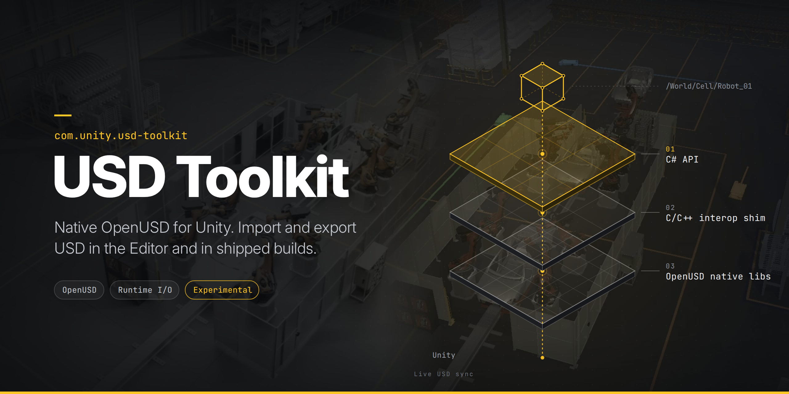
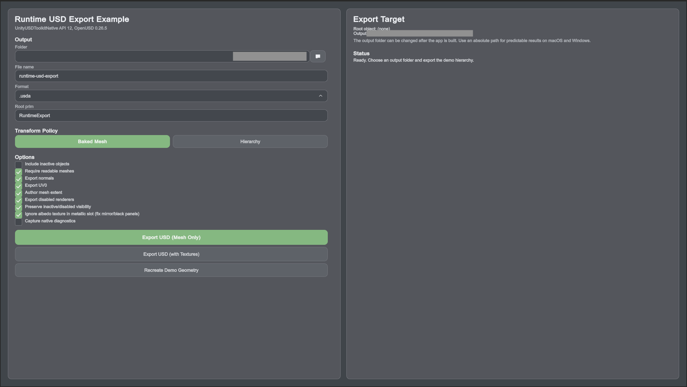
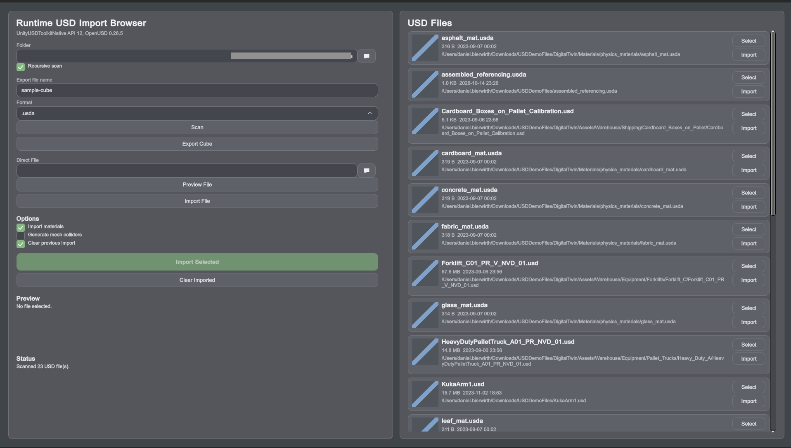
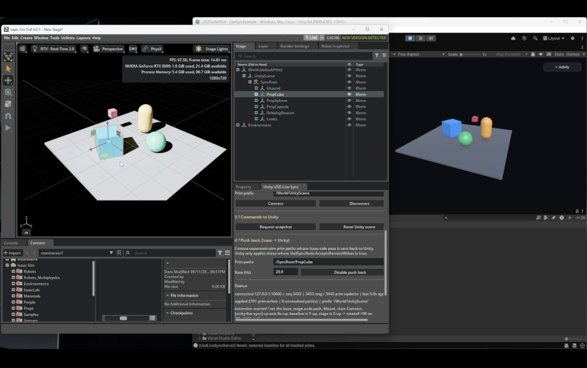
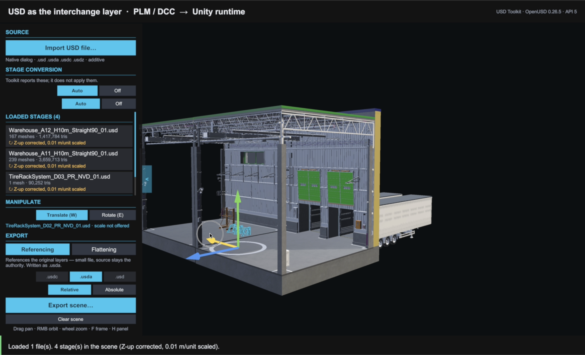
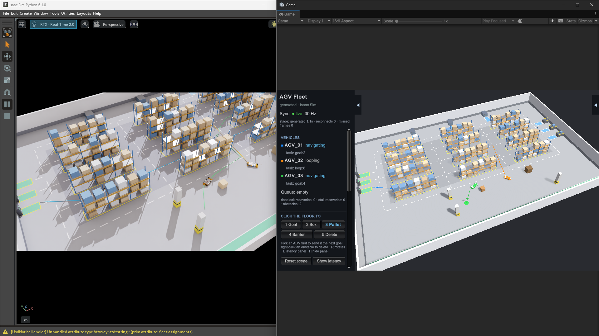
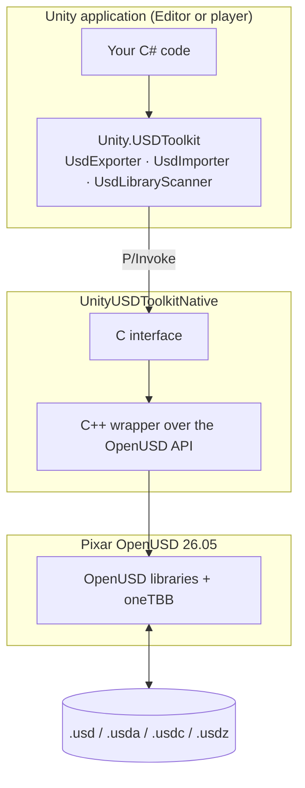

# Unity USD Toolkit


[](LICENSE.md)

<p align="center"></p>

Read and write OpenUSD stages from Unity at runtime, in the Editor and in built players, through Pixar's native OpenUSD 26.05 libraries.

---

The Unity USD Toolkit connects Unity to OpenUSD-based simulation pipelines such as NVIDIA Isaac Sim and Omniverse. It reads and writes the same `.usd`, `.usda`, `.usdc` and `.usdz` files those tools use, with no intermediate format, so you can author a scene in Unity, open it in Isaac Sim, and bring changes back.

The package includes four key capabilities:

- **Runtime export,** which writes any GameObject hierarchy to USD from a running application, with `UsdPreviewSurface` materials and optional PNG textures.
- **Runtime import,** which loads USD stages into GameObjects without freezing the frame, with a preview of mesh and triangle counts before you commit.
- **Safe handling of untrusted files,** which confines texture paths to the stage folder, checks mesh topology and caps image sizes, so you can open USD files from any source.
- **USD Live Sync (prototype),** a sample that streams transform changes between the Unity Editor and Isaac Sim 6.1.0 in both directions.

> **Experimental package.** `com.unity.usd-toolkit` is experimental. The API can change in any `0.x` release, and the package is not supported for production use.

---

## Who this is for

Teams in automotive, manufacturing, robotics and simulation who exchange USD with tools such as NVIDIA Isaac Sim and need Unity to read and write the same stages: static geometry, transform hierarchies, materials and textures.

The toolkit is not a renderer or a simulation runtime. Unity renders imported content with its own materials and render pipeline, and the package does not author or run physics.

## Requirements

| Requirement | Detail |
| --- | --- |
| **Unity** | **6.4 and newer.** |
| **Windows** | x64, Windows 10 version 21H1 or later. Requires the Microsoft Visual C++ Redistributable. |
| **macOS** | Universal (x86_64 + arm64), macOS 12.0 or later. |
| **Linux** | x64, Ubuntu 22.04 or later (glibc 2.34, `GLIBCXX_3.4.29`). |
| **Git LFS** | Required if you install from Git. The native libraries are stored with LFS. |

## Installation

1. Open **Window > Package Management > Package Manager**.
2. Select **+ > Add package from git URL**.
3. Enter the following URL, then select **Add**:

   ```text
   https://github.com/Unity-Technologies/com.unity.usd-toolkit.git
   ```

You can also add the package to `Packages/manifest.json`:

```json
{
  "dependencies": {
    "com.unity.usd-toolkit": "https://github.com/Unity-Technologies/com.unity.usd-toolkit.git"
  }
}
```

To install from a local clone or a tarball from the [Releases](https://github.com/Unity-Technologies/com.unity.usd-toolkit/releases) page, use **+ > Add package from disk** or **+ > Add package from tarball**. For a local clone, run `git lfs pull` first.

## Quick start

1. Install the package in a Unity 6.4 or newer project.
2. Create a script named `OpenUsdStage.cs` with the code below.
3. Add the component to an empty GameObject.
4. In the Inspector, set **Usd Path** to the absolute path of a `.usd`, `.usda`, `.usdc` or `.usdz` file.
5. Enter Play mode.

The stage appears as children of the GameObject, and the Console prints a summary. Geometry appears first and textures attach as they finish decoding; set `StreamTextures = false` to have `ImportAsync` return only when everything is loaded.

```csharp
using Unity.USDToolkit;
using UnityEngine;

public class OpenUsdStage : MonoBehaviour
{
    [SerializeField] private string usdPath;

    private async void Start()
    {
        UsdImportPreviewInfo preview = UsdImporter.GetPreviewInfo(usdPath);
        Debug.Log($"{preview.MeshCount} meshes, {preview.TriangleCount} triangles, up axis {preview.UpAxis}");

        UsdImportResult result = await UsdImporter.ImportAsync(usdPath, new UsdImportOptions
        {
            Parent = transform,
            ImportMaterials = true,
            ImportTextures = true
        });

        // ImportAsync returns once the objects are built; textures keep streaming in.
        await result.TexturesReady;
        Debug.Log(result.ToString());
    }
}
```

To write a stage instead:

```csharp
UsdExportResult result = UsdExporter.ExportGameObjectWithResult(
    exportRoot,
    System.IO.Path.Combine(Application.persistentDataPath, "scene.usda"),
    new UsdExportOptions { TransformPolicy = UsdTransformPolicy.PreserveHierarchy });
```

## Samples

To add the samples to your project:

1. Open **Window > Package Management > Package Manager**.
2. Select **Unity USD Toolkit**, then open the **Samples** tab.
3. Next to **Runtime Examples**, **Live Sync Example**, **Runtime Demo** or **AGV Fleet LiveSync Demo**, select **Import**.

Unity copies each sample to `Assets/Samples/Unity USD Toolkit/<version>/<sample>`, where you can open and edit the scenes. This works the same for every install method, including Git URLs and tarballs, which Unity installs as read-only packages. The two Runtime Examples scenes share one UI theme, so they import together. The package doesn't compile the samples until you import them.

| Preview | Sample | Scene | What it shows |
| --- | --- | --- | --- |
| <a href="Samples~/Runtime%20Examples/Export%20Example/README.md"></a> | **[Export Example](Samples~/Runtime%20Examples/Export%20Example/README.md)** | `Export Example/RuntimeExportExample.unity` | A runtime UI that exports the open scene to any USD format, with or without textures, as baked meshes or a preserved hierarchy. |
| <a href="Samples~/Runtime%20Examples/Import%20Example/README.md"></a> | **[Import Example](Samples~/Runtime%20Examples/Import%20Example/README.md)** | `Import Example/RuntimeImportBrowser.unity` | A runtime browser that scans a folder for USD files, previews their statistics and imports them. |
| <a href="Samples~/Live%20Sync%20Example/README.md"></a> | **[USD Live Sync](Samples~/Live%20Sync%20Example/README.md)** | `LiveSyncExample.unity` | Two-way transform sync between the Unity Editor and Isaac Sim 6.1.0 or a Python client. |
| <a href="Samples~/Runtime%20Demo/README.md"></a> | **[Runtime Demo](Samples~/Runtime%20Demo/README.md)** | `Scenes/USDRuntimeDemo.unity` | A runtime app that imports several USD files, lets you select and move parts with a transform gizmo, corrects Z-up and centimetre files, and exports the result as a referencing layer or a flattened stage. |
| <a href="Samples~/AGVFleet_LiveSync%20Demo/README.md"></a> | **[AGV Fleet LiveSync Demo](Samples~/AGVFleet_LiveSync%20Demo/README.md)** | `Scenes/AGVFleet_LiveSync.unity` | An AGV fleet in NVIDIA's factory scene (downloaded separately) or a generated warehouse hall, with Unity as the operator front end and Isaac Sim 6.1.0 simulating the fleet over a shared USD stage. [Video](https://youtu.be/P8_rpQgEzSU). |

The Export and Import examples import together as **Runtime Examples**. **Live Sync Example**, **Runtime Demo** and **AGV Fleet LiveSync Demo** are separate samples; Runtime Demo needs URP, the Input System and uGUI in the project, and AGV Fleet LiveSync Demo needs URP and the Input System.

If you imported the samples before, delete the old copy under `Assets/Samples/Unity USD Toolkit` before you import them again.

## Workflows

### Import an Isaac Sim scene into Unity

1. Save the stage from Isaac Sim as `.usd`, `.usda`, `.usdc` or `.usdz`. Keep referenced textures in the stage's folder.
2. Call `UsdImporter.GetPreviewInfo` to check the mesh count, up axis and units.
3. Call `UsdImporter.ImportAsync` from the main thread.

The importer applies the stage's up axis and `metersPerUnit` to the import root, so an Isaac Sim stage, which is Z-up by default, arrives Y-up and in meters. The correction sits only on the root's local rotation and scale. Vertices and every prim's local transform stay as authored, so a `Preserve` export writes no override for it. `UsdImportResult.StageCorrectionRotation` and `StageCorrectionScale` report what was applied. To get the stage's raw coordinates under an identity root instead, turn the correction off:

```csharp
UsdImportResult result = await UsdImporter.ImportAsync(path, new UsdImportOptions
{
    ApplyStageUpAxisAndUnits = false // Keep the stage's own up axis and units.
});
```

### Export a Unity scene for Isaac Sim

1. Choose the root GameObject to export.
2. Call `UsdExporter.ExportGameObjectWithResult`. Set `TransformPolicy = UsdTransformPolicy.PreserveHierarchy` to keep the transform hierarchy, and `ExportTextures = true` to write PNG textures.
3. Open the result in Isaac Sim, or check it with `usdchecker`.

### Keep USD composition (round trip, prefabs, instancing)

Set `Composition = UsdCompositionMode.Preserve` to write composition instead of copies:

- **Import, edit, export back.** An imported stage is written as a layer that sublayers the source file and holds only what changed in Unity (moves, visibility, deletions, additions, variant selections). Every reference, payload, variant set, inherit and specialize in the source survives.
- **Prefabs.** Each prefab is written once, in the file or as its own file (`Layout = UsdExportLayout.FolderWithAssets`), and its instances reference it, with their differences as overrides. This works in players too: scene instances are marked automatically, and runtime instances made with `UsdPrefabMarker.Instantiate`.
- **Repeated meshes.** With `ShareMeshes = true`, objects sharing a mesh and materials become instances of one prototype.

On import, `UsdImportOptions.VariantSelections` picks variants and `LoadPayloads` / `PayloadsToLoad` choose which payloads load; `UsdImportResult.Source` lists the stage's variant sets, payloads and arcs. These need native API 6. See the manual's *Keep USD composition* section.

## Features

| | Export (`UsdExporter`) | Import (`UsdImporter`) |
| --- | --- | --- |
| **Formats** | `.usd`, `.usda`, `.usdc`, `.usdz` (with an optional ARKit-compatible mode) | `.usd`, `.usda`, `.usdc`, `.usdz` |
| **Geometry** | Static meshes, including meshes without **Read/Write Enabled** | Static `UsdGeomMesh`, implicit surfaces (`Cube`, `Sphere`, `Cylinder`, `Cone`, `Capsule`, `Plane`) as meshes, with optional `MeshCollider`. `PointInstancer` placements are drawn from their arrays by a `UsdPointInstancer` component (culled by cell; Mesh LOD levels for the prototypes from **GameObject > USD > Generate Mesh LODs for Point Instancers**), not as GameObjects, so instances cannot be selected one by one and get no collider. Smooth normals are generated when none are authored. Subdivision surfaces arrive as their control cage, with a warning |
| **Transforms** | Baked into mesh points, or kept as an `Xform` hierarchy | Every transformable prim becomes a GameObject, including typeless and custom-schema prims; `proxy` and `guide` purpose prims are skipped. The stage's up axis and units are applied on the import root |
| **Materials** | `UsdPreviewSurface`: base color, opacity, metallic, roughness, emission; one binding per submesh | `UsdPreviewSurface`, MaterialX (`standard_surface`, `open_pbr_surface`, `UsdPreviewSurface`, including `.mtlx` files) and MDL `OmniPBR`, `OmniSurface` and `OmniGlass` colors and textures become URP, HDRP or Built-in materials. A `UsdPrimvarReader` color such as `displayColor` on `diffuseColor` is read. Unbound meshes get a grey `UsdDefaultMaterial` |
| **Textures** | Albedo, normal, metallic-smoothness and emission as PNG, with UV tiling and offset | The same set from PNG, OpenEXR and JPEG (JPEG through Unity's decoder on the main thread), including UDIM sets of PNG or EXR tiles (stitched into an atlas), separate metallic, roughness and occlusion maps and OmniPBR ORM maps (packed for Unity), `material:binding:full` and `preview` bindings, textures inside `.usdz` packages and textures referenced from material layers in sub-folders. Block-compressed (BC1/BC3) by default |
| **Lights, cameras, audio** | | UsdLux distant, sphere, disk, cylinder and rect lights become Unity `Light`s, `UsdGeomCamera` becomes a disabled `Camera`, and `UsdMediaSpatialAudio` becomes an `AudioSource` (clip not loaded). A dome light is recorded on `UsdDomeLight` and can set the ambient color and skybox. Needs native API 7 |
| **Composition** | Sublayers, references, prefab assets, instancing and sparse overrides (`UsdCompositionMode.Preserve`) | Fully composed; variant selection and payload loading control |
| **Performance** | | Asynchronous import, spread across frames, with textures streamed in after the geometry (`TexturesReady`); textures decoded and compressed in parallel in native code; statistics preview before import, whose stage the import reuses; instances with identical geometry share one `Mesh` |

**Not supported yet:** skinned meshes, animation, subdivision (surfaces are imported as their control cage), MDL materials other than `OmniPBR`, `OmniSurface` and `OmniGlass`, and physics schemas.

## Architecture

The package has three layers. Only the C# API is public.

1. **C# API** (`Unity.USDToolkit`): `UsdExporter`, `UsdImporter` and `UsdLibraryScanner` convert between Unity objects and USD data.
2. **Native plugin** (`UnityUSDToolkitNative`): a C++ library that wraps the OpenUSD API behind a small C interface, called through P/Invoke. The shipped plugin is native API 12; the package accepts API 6 or newer and switches features on by the version the plugin reports.
3. **OpenUSD 26.05**: Pixar's OpenUSD libraries and oneTBB, built for each platform and shipped in `Runtime/Plugins`.



The package does not depend on `com.unity.formats.usd`, `com.unity.importer.usd`, `com.unity.exporter.usd`, `com.unity.usd.core` or USD.NET.

### Comparison with other USD packages

| | Unity USD Toolkit | USD for Unity (`com.unity.formats.usd`) | USD Importer / Exporter (`com.unity.importer.usd`, `com.unity.exporter.usd`) |
| --- | --- | --- | --- |
| **USD version** | OpenUSD 26.05 | USD 20.08 | USD 23.02 |
| **Read / write** | Import and export | Import and export | Importer: import. Exporter: export. |
| **Runs in** | Editor and built players | Editor | Editor |
| **Platforms** | Windows x64, macOS (Intel and Apple silicon), Linux x64 | Windows, macOS Intel | Windows, macOS, Linux |

## Documentation

| Document | Contents |
| --- | --- |
| [User Manual](Documentation~/Unity%20USD%20Toolkit%20User%20Manual%20EN.md) | Export and import options, threading, materials, untrusted file handling, standalone builds, troubleshooting and the API reference. |
| [Live Sync Example](Samples~/Live%20Sync%20Example/README.md) | Setup, wire protocol, ownership, coordinate conversion and security. |
| [Isaac Sim client](Samples~/Live%20Sync%20Example/Tools~/isaacsim/README.md) | The Kit extension, launchers and troubleshooting. |
| [Changelog](CHANGELOG.md) | Release history. |

## Troubleshooting

| Symptom | Cause | Solution |
| --- | --- | --- |
| `DllNotFoundException` | The native libraries are missing or are still Git LFS pointer files. | Run `git lfs pull`. |
| `native API version mismatch` | A locally built plugin is older than API 6. | Rebuild it from `Native~`, or use the shipped payload. |
| The surface renders black in Isaac Sim | The albedo texture is also assigned to the metallic slot. | Keep `IgnoreAlbedoInMetallicSlot` enabled (the default), or assign a separate metallic map. |
| Materials are flat right after `ImportAsync` | Textures stream in after the objects are built. | `await result.TexturesReady` before exporting, capturing or inspecting materials, or set `StreamTextures = false`. |
| Textures are missing after import | A texture path points outside the stage folder. | Move the textures next to the stage. For files you trust, set `AllowExternalAssetPaths = true`. |
| Exporting a mesh fails in batch mode | Meshes without **Read/Write Enabled** need a graphics device. | Enable **Read/Write Enabled** on the meshes. |
| The package works in the Editor but not in a player | The player targets an unsupported platform. | Build for Windows x64, macOS or Linux x64. |

For more, see [Troubleshooting](Documentation~/Unity%20USD%20Toolkit%20User%20Manual%20EN.md#13-troubleshooting) in the User Manual.

---

## Support

For bugs and feature requests, file a [GitHub issue](https://github.com/Unity-Technologies/com.unity.usd-toolkit/issues). Include your Unity version, platform, package version, and the output of `UsdExporter.GetRuntimeInfo()`.

This repository doesn't accept external contributions.

## License

Unity USD Toolkit Package © 2026 Unity Technologies. Licensed under the Unity Companion License for Unity-dependent projects. See [LICENSE.md](LICENSE.md).

Third-party components redistributed with the package remain licensed under their own terms. See [Third-party notices](ThirdPartyNotices.md).

This package does not include or redistribute any NVIDIA software. NVIDIA Isaac Sim and NVIDIA Omniverse are licensed to you by NVIDIA under NVIDIA's own terms.

### Third Party Product disclaimer

The following concerns a product or service (each a "Third Party Product") that
is not developed, owned, or operated by Unity. This information may not be
up-to-date or complete, and is provided to you for your information and
convenience only. Your access and use of any Third Party Product is governed
solely by the terms and conditions of such Third Party Product. Unity makes no
express or implied representations or warranties regarding such Third Party
Products, and will not be responsible or liable, directly or indirectly, for any
actual or alleged damage or loss arising from your use thereof (including damage
or loss arising from any content, advertising, products or other materials on or
available from the provider of any Third Party Products).

### Trademarks

NVIDIA, NVIDIA Isaac Sim, and NVIDIA Omniverse are trademarks and/or registered
trademarks of NVIDIA Corporation in the U.S. and other countries. Universal
Scene Description (USD), OpenUSD, and Pixar are trademarks and/or registered
trademarks of Pixar in the U.S. and other countries. Intel and oneAPI are
trademarks of Intel Corporation or its subsidiaries. Microsoft, Windows, and
Visual C++ are trademarks of the Microsoft group of companies. macOS is a
trademark of Apple Inc. Unity, the Unity logo, and other Unity trademarks are
trademarks or registered trademarks of Unity Technologies or its affiliates in
the U.S. and elsewhere. All other trademarks are the property of their
respective owners. Use of a third-party name or mark in this package is for
identification only and does not imply any endorsement, sponsorship, or
affiliation.
