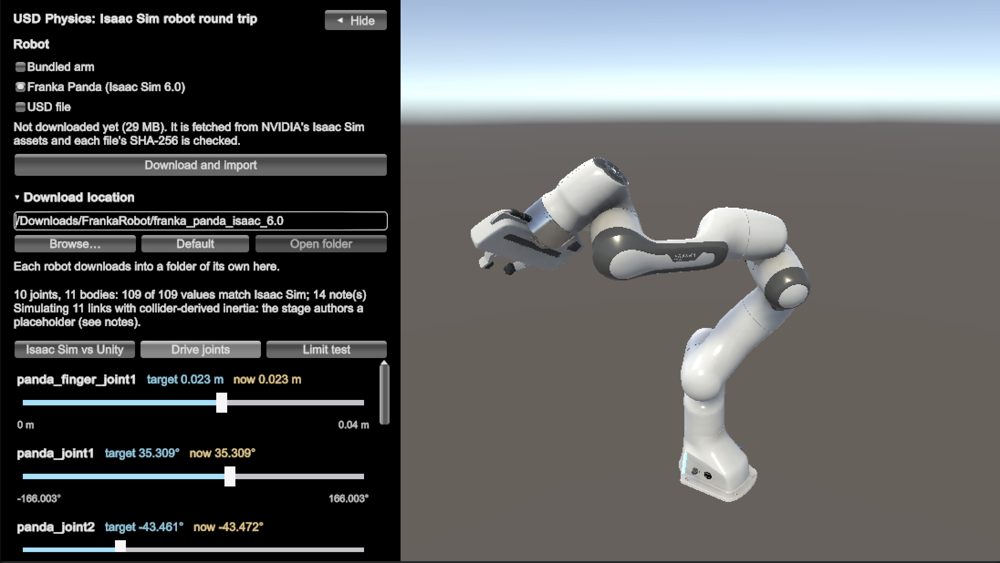
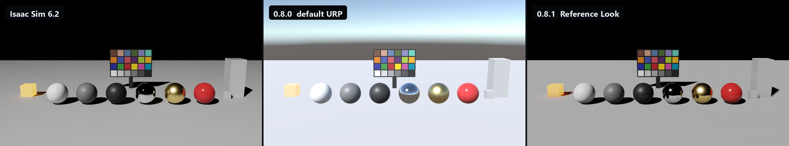
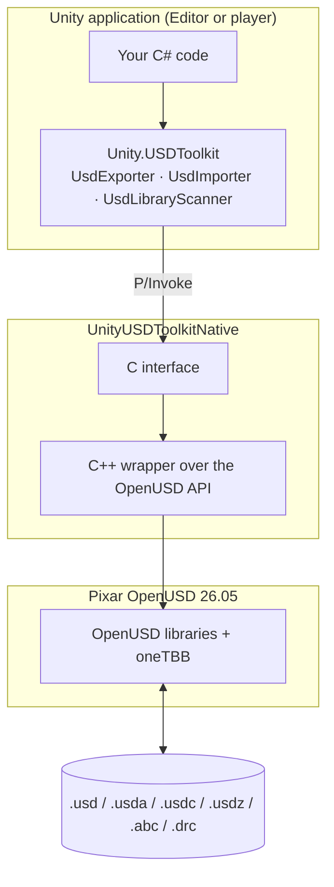

# Unity USD Toolkit


[](LICENSE.md)

<p align="center"></p>

Read and write OpenUSD stages from Unity at runtime, in the Editor and in built players, through Pixar's native OpenUSD 26.05 libraries.

---

The Unity USD Toolkit connects Unity to OpenUSD-based simulation pipelines such as NVIDIA Isaac Sim and Omniverse. It reads and writes the same `.usd`, `.usda`, `.usdc` and `.usdz` files those tools use, with no intermediate format, so you can author a scene in Unity, open it in Isaac Sim, and bring changes back.

The package includes four key capabilities:

- **Runtime export,** which writes any GameObject hierarchy to USD from a running application, with `UsdPreviewSurface` materials, optional PNG textures, lights and cameras.
- **Runtime import,** which loads USD stages into GameObjects without freezing the frame, with a preview of mesh and triangle counts before you commit. `UsdPreviewSurface`, MaterialX and OmniPBR materials become Unity materials.
- **Safe handling of untrusted files,** which confines texture paths to the stage folder, checks mesh topology and caps image sizes, so you can open USD files from any source.
- **USD Live Sync,** a sample that streams transform changes between the Unity Editor and Isaac Sim in both directions, and the AGV Fleet LiveSync Demo built on it.

✨ **New in 0.8.1:**

- ✨ **Animation.** Time-sampled transforms, UsdSkel skeletons, blend shapes and point caches play back with `UsdAnimationPlayer`; `UsdAnimationRecorder` records Unity animation to USD.
- ✨ **Physics on import.** UsdPhysics becomes `ArticulationBody` chains, rigidbodies, colliders and physics materials, so an Isaac Sim robot moves in Unity with the same limits and drives (`UsdImportOptions.ImportPhysics`).
- ✨ **USD composition and a stage API.** References, payloads, variants and instancing survive a round trip, variants and payloads switch at runtime, and `UsdStage` reads and edits stages from C#.

> **Experimental package.** `com.unity.usd-toolkit` is experimental. The API can change in any `0.x` release, and the package is not supported for production use.

---

## Who this is for

Teams in automotive, manufacturing, robotics and simulation who exchange USD with tools such as NVIDIA Isaac Sim and need Unity to read and write the same stages: geometry, transform hierarchies, materials and textures, animation and robot physics.

The toolkit is not a renderer or a simulation runtime. Unity renders imported content with its own materials and render pipeline, and imported physics runs on Unity's own physics engine.

## Requirements

| Requirement | Detail |
| --- | --- |
| **Unity** | **6.4 and newer.** |
| **Windows** | x64, Windows 10 version 21H1 or later. Requires the Microsoft Visual C++ Redistributable. |
| **macOS** | Universal (x86_64 + arm64), macOS 12.0 or later. |
| **Linux** | x64, Ubuntu 22.04 or later (glibc 2.34, `GLIBCXX_3.4.29`). |
| **Render pipelines** | Built-in, URP and HDRP for import and export. The Runtime Demo, AGV Fleet and Reference Look samples need URP. |
| **Git LFS** | Required if you install from Git. The native libraries are stored with LFS. |

Mobile, WebGL and console platforms are not supported.

## Installation

1. Open **Window > Package Management > Package Manager**.
2. Select **+ > Add package from git URL**.
3. Enter the following URL, then select **Add**:

   ```text
   https://github.com/Unity-Technologies/com.unity.usd-toolkit.git
   ```

Add `#<tag>` to the URL to pin a release, for example `...usd-toolkit.git#v0.8.1-exp.1`; the [Releases](https://github.com/Unity-Technologies/com.unity.usd-toolkit/releases) page lists them. Don't install from **Code > Download ZIP** or from a release's source archive: those leave out the native libraries, which are stored with Git LFS. To install from `Packages/manifest.json` or a local clone, see [Install the package](Documentation~/Unity%20USD%20Toolkit%20User%20Manual%20EN.md#3-install-the-package) in the manual.

## Quick start

1. Install the package in a Unity 6.4 or newer project.
2. Create a script named `OpenUsdStage.cs` with the code below.
3. Add the component to an empty GameObject.
4. In the Inspector, set **Usd Path** to the absolute path of a `.usd`, `.usda`, `.usdc` or `.usdz` file.
5. Enter Play mode.

The stage appears as children of the GameObject, and the Console prints a summary. Geometry appears first and textures attach as they finish decoding; set `StreamTextures = false` to have `ImportAsync` return only when everything is loaded.

```csharp
using Unity.USDToolkit;
using UnityEngine;

public class OpenUsdStage : MonoBehaviour
{
    [SerializeField] private string usdPath;

    private async void Start()
    {
        UsdImportPreviewInfo preview = UsdImporter.GetPreviewInfo(usdPath);
        Debug.Log($"{preview.MeshCount} meshes, {preview.TriangleCount} triangles, up axis {preview.UpAxis}");

        UsdImportResult result = await UsdImporter.ImportAsync(usdPath, new UsdImportOptions
        {
            Parent = transform,
            ImportMaterials = true,
            ImportTextures = true
        });

        // ImportAsync returns once the objects are built; textures keep streaming in.
        await result.TexturesReady;
        Debug.Log(result.ToString());
    }
}
```

To write a stage instead:

```csharp
UsdExportResult result = UsdExporter.ExportGameObjectWithResult(
    exportRoot,
    System.IO.Path.Combine(Application.persistentDataPath, "scene.usda"),
    new UsdExportOptions { TransformPolicy = UsdTransformPolicy.PreserveHierarchy });
```

## Samples

To add the samples to your project:

1. Open **Window > Package Management > Package Manager**.
2. Select **Unity USD Toolkit**, then open the **Samples** tab.
3. Next to **Runtime Examples**, **Live Sync Example**, **Runtime Demo**, **AGV Fleet LiveSync Demo**, **Isaac Robot Physics** or **Reference Look**, select **Import**.

Unity copies each sample to `Assets/Samples/Unity USD Toolkit/<version>/<sample>`, where you can open and edit the scenes. This works for every install method, including a Git URL, which Unity installs as a read-only package. The package doesn't compile the samples until you import them.

<table>
<tr>
<td width="50%" valign="top"><a href="Samples~/Runtime%20Examples/Export%20Example/README.md"></a><br><b><a href="Samples~/Runtime%20Examples/Export%20Example/README.md">Export Example</a></b><br>A runtime UI that exports the open scene to any USD format, with or without textures, as baked meshes or a preserved hierarchy.</td>
<td width="50%" valign="top"><a href="Samples~/Runtime%20Examples/Import%20Example/README.md"></a><br><b><a href="Samples~/Runtime%20Examples/Import%20Example/README.md">Import Example</a></b><br>A runtime browser that scans a folder for USD files, previews their statistics and imports them.</td>
</tr>
<tr>
<td width="50%" valign="top"><a href="Samples~/Live%20Sync%20Example/README.md"></a><br><b><a href="Samples~/Live%20Sync%20Example/README.md">USD Live Sync</a></b><br>Two-way transform sync between the Unity Editor and Isaac Sim 6.1 or a Python client.</td>
<td width="50%" valign="top"><a href="Samples~/Runtime%20Demo/README.md"></a><br>✨ <b><a href="Samples~/Runtime%20Demo/README.md">Runtime Demo</a></b><br>A runtime app that imports several USD files, lets you move parts with a gizmo, and exports the result as a referencing layer or a flattened stage.</td>
</tr>
<tr>
<td width="50%" valign="top"><a href="Samples~/AGVFleet_LiveSync%20Demo/README.md"></a><br>✨ <b><a href="Samples~/AGVFleet_LiveSync%20Demo/README.md">AGV Fleet LiveSync Demo</a></b><br>Isaac Sim simulates an AGV fleet in a factory or a generated warehouse; Unity is the operator front end over a shared USD stage. <a href="https://youtu.be/P8_rpQgEzSU">Video</a>.</td>
<td width="50%" valign="top"><a href="Samples~/Isaac%20Robot%20Physics/README.md"></a><br>✨ <b><a href="Samples~/Isaac%20Robot%20Physics/README.md">Isaac Robot Physics</a></b><br>Imports an Isaac Sim robot with its physics and compares every joint limit, drive and mass with what Isaac Sim shows; drives the joints in Play Mode.</td>
</tr>
<tr>
<td colspan="2" valign="top"><a href="Samples~/ReferenceLook/README.md"></a><br>✨ <b><a href="Samples~/ReferenceLook/README.md">Reference Look</a></b> <i>(experimental)</i><br>A URP render setup that brings an imported stage close to Isaac Sim's RTX Real-Time renderer, with a menu that imports a USD file and fits the lighting to it. Needs Unity 6.7, which is in beta; the sample stays experimental until 6.7 ships and the setup is tuned for it.</td>
</tr>
</table>

✨ marks the samples added since 0.8.0. The Export and Import examples import together as **Runtime Examples**; the others are separate samples. Runtime Demo needs URP, the Input System and uGUI in the project, AGV Fleet LiveSync Demo needs URP and the Input System, and Reference Look needs URP.

If you imported the samples before, delete the old copy under `Assets/Samples/Unity USD Toolkit` before you import them again.

## Workflows

### Import an Isaac Sim scene into Unity

1. Save the stage from Isaac Sim as `.usd`, `.usda`, `.usdc` or `.usdz`. Keep referenced textures in the stage's folder.
2. Call `UsdImporter.GetPreviewInfo` to check the mesh count, up axis and units.
3. Call `UsdImporter.ImportAsync` from the main thread.

The importer applies the stage's up axis and `metersPerUnit` to the import root, so an Isaac Sim stage, which is Z-up by default, arrives Y-up and in meters. The correction sits only on the root; vertices and every prim's local transform stay as authored. Set `ApplyStageUpAxisAndUnits = false` to keep the stage's own coordinates. See [Up axis and units](Documentation~/Unity%20USD%20Toolkit%20User%20Manual%20EN.md#up-axis-and-units) in the manual.

### Export a Unity scene for Isaac Sim

1. Choose the root GameObject to export.
2. Call `UsdExporter.ExportGameObjectWithResult`. Set `TransformPolicy = UsdTransformPolicy.PreserveHierarchy` to keep the transform hierarchy, and `ExportTextures = true` to write PNG textures.
3. Open the result in Isaac Sim, or check it with `usdchecker`.

### Import an Isaac Sim robot with its physics

1. Set `UsdImportOptions.ImportPhysics = true` (it is off by default) and import the robot's stage.
2. Each articulation arrives as an `ArticulationBody` chain with the joint limits, drives, masses and collision filtering the stage authors.
3. Enter Play mode: Unity's physics engine runs the robot, and you drive it through the `ArticulationBody` API.

The **Isaac Robot Physics** sample does this for a bundled arm or NVIDIA's Franka Panda and compares every value with what Isaac Sim shows. See [Physics](Documentation~/Unity%20USD%20Toolkit%20User%20Manual%20EN.md#physics) in the manual.

### Round-trip a stage without flattening it

Set `Composition = UsdCompositionMode.Preserve` on export. An imported stage is then written as a layer over the source file that holds only what changed in Unity, and every reference, payload and variant in the source survives. Prefabs are written once and referenced, and repeated meshes become instances. On import, `UsdImportOptions.VariantSelections` and `LoadPayloads` choose what to compose, and `UsdImportResult.Source` switches variants and payloads at runtime. See [Keep USD composition](Documentation~/Unity%20USD%20Toolkit%20User%20Manual%20EN.md#keep-usd-composition) and [Read and edit stages from C#](Documentation~/Unity%20USD%20Toolkit%20User%20Manual%20EN.md#read-and-edit-stages-from-c) in the manual.

## Features

The [User Manual](Documentation~/Unity%20USD%20Toolkit%20User%20Manual%20EN.md#2-supported-platforms-and-features) lists every supported prim type, material and option. The table compares the toolkit with Unity's earlier USD package.

| | Unity USD Toolkit | USD for Unity (`com.unity.formats.usd`) |
| --- | --- | --- |
| **Isaac Sim Live Sync** | Two-way sync between the Unity Editor and Isaac Sim, with the AGV Fleet demo | Not available |
| **Status** | In active development (experimental) | Deprecated since November 2024 |
| **Unity and OpenUSD** | Unity 6.4 and newer, OpenUSD 26.05 | Unity 2019.4, USD 20.08; does not compile on Unity 6 |
| **Runs in** | Editor and built players | Editor only |
| **Platforms** | Windows, macOS (Intel and Apple silicon), Linux | Windows, macOS Intel |
| **Load time** | About 2.7x faster on the same scene in our tests | Baseline |
| **Textures** | UDIM, EXR, packed ORM maps, streamed in after the geometry | One UV set; UDIM and MDL textures not read |
| **Materials** | UsdPreviewSurface, MaterialX and Omniverse MDL, to URP, HDRP or Built-in | Standard Shader; limited URP and HDRP |
| **Lights** | UsdLux lights and dome lights | Not supported |
| **Animation** | UsdSkel, blend shapes and point caches on import; Unity animation recorded back to USD | UsdSkel and animated meshes through Timeline; no blend shapes |
| **Physics** | UsdPhysics to `ArticulationBody` chains, rigidbodies and colliders | Not supported |
| **Composition** | References, payloads and variants kept through a round trip; variants switched at runtime; `UsdStage` C# API | Variant selection and payload loading in the Editor |
| **Other formats** | Alembic `.abc`, Draco `.drc` | USD only |

**Not supported yet:** physics on export, subdivision surfaces (imported as their control cage), point caches whose topology changes over time, MDL materials other than `OmniPBR`, `OmniSurface` and `OmniGlass`, materials in Alembic files, and Draco on Windows.

## Architecture

The package has three layers. Only the C# API is public.

1. **C# API** (`Unity.USDToolkit`): `UsdExporter`, `UsdImporter` and `UsdLibraryScanner` convert between Unity objects and USD data.
2. **Native plugin** (`UnityUSDToolkitNative`): a C++ library that wraps the OpenUSD API behind a small C interface, called through P/Invoke. Each release ships the plugin for Windows, macOS and Linux; the package loads one from 0.8.0 or newer and switches features on by the release the plugin comes from (see *Native plugin versions* in the manual).
3. **OpenUSD 26.05**: Pixar's OpenUSD libraries and oneTBB, built for each platform and shipped in `Runtime/Plugins`.



The package does not depend on `com.unity.formats.usd`, `com.unity.importer.usd`, `com.unity.exporter.usd`, `com.unity.usd.core` or USD.NET.

## Documentation

| Document | Contents |
| --- | --- |
| [User Manual](Documentation~/Unity%20USD%20Toolkit%20User%20Manual%20EN.md) | Export and import options, threading, materials, animation, physics, untrusted file handling, standalone builds, troubleshooting and the API reference. |
| [User Manual (Korean)](Documentation~/Unity%20USD%20Toolkit%20User%20Manual%20KR.md) | The same manual in Korean. |
| [Live Sync Example](Samples~/Live%20Sync%20Example/README.md) | Setup, wire protocol, ownership, coordinate conversion and security. |
| [AGV Fleet LiveSync Demo](Samples~/AGVFleet_LiveSync%20Demo/README.md) | The fleet demo: Isaac Sim side, Unity side, the shared stage and the hub. |
| [Runtime Demo](Samples~/Runtime%20Demo/README.md), [Isaac Robot Physics](Samples~/Isaac%20Robot%20Physics/README.md), [Reference Look](Samples~/ReferenceLook/README.md) | Each sample's own guide. |
| [Isaac Sim client](Samples~/Live%20Sync%20Example/Tools~/isaacsim/README.md) | The Kit extension, launchers and troubleshooting. |
| [Changelog](CHANGELOG.md) | Release history. |

## Troubleshooting

| Symptom | Cause | Solution |
| --- | --- | --- |
| `DllNotFoundException` | The native libraries are missing or are still Git LFS pointer files, for example after a ZIP download. | Install from the git URL, or run `git lfs pull` in a clone. |
| An imported robot has no `ArticulationBody` | `ImportPhysics` is off by default. | Set `UsdImportOptions.ImportPhysics = true`, and check `UsdImportResult.PhysicsNotes`. |

Black surfaces in Isaac Sim, flat materials right after import, missing textures, batch-mode export and player builds are covered in [Troubleshooting](Documentation~/Unity%20USD%20Toolkit%20User%20Manual%20EN.md#14-troubleshooting) in the User Manual.

---

## Support

Report bugs and request features through [GitHub Issues](https://github.com/Unity-Technologies/com.unity.usd-toolkit/issues). The issue template asks for the USD file that shows the problem; most reports cannot be reproduced without it. This repository doesn't accept external contributions.

## License

Unity USD Toolkit Package © 2026 Unity Technologies. Licensed under the Unity Companion License for Unity-dependent projects. See [LICENSE.md](LICENSE.md).

Third-party components redistributed with the package remain licensed under their own terms. See [Third-party notices](ThirdPartyNotices.md).

This package does not include or redistribute any NVIDIA software. NVIDIA Isaac Sim and NVIDIA Omniverse are licensed to you by NVIDIA under NVIDIA's own terms.

### Third Party Product disclaimer

The following concerns a product or service (each a "Third Party Product") that
is not developed, owned, or operated by Unity. This information may not be
up-to-date or complete, and is provided to you for your information and
convenience only. Your access and use of any Third Party Product is governed
solely by the terms and conditions of such Third Party Product. Unity makes no
express or implied representations or warranties regarding such Third Party
Products, and will not be responsible or liable, directly or indirectly, for any
actual or alleged damage or loss arising from your use thereof (including damage
or loss arising from any content, advertising, products or other materials on or
available from the provider of any Third Party Products).

### Trademarks

NVIDIA, NVIDIA Isaac Sim, and NVIDIA Omniverse are trademarks and/or registered
trademarks of NVIDIA Corporation in the U.S. and other countries. Universal
Scene Description (USD), OpenUSD, and Pixar are trademarks and/or registered
trademarks of Pixar in the U.S. and other countries. Intel and oneAPI are
trademarks of Intel Corporation or its subsidiaries. Microsoft, Windows, and
Visual C++ are trademarks of the Microsoft group of companies. macOS is a
trademark of Apple Inc. Unity, the Unity logo, and other Unity trademarks are
trademarks or registered trademarks of Unity Technologies or its affiliates in
the U.S. and elsewhere. All other trademarks are the property of their
respective owners. Use of a third-party name or mark in this package is for
identification only and does not imply any endorsement, sponsorship, or
affiliation.
