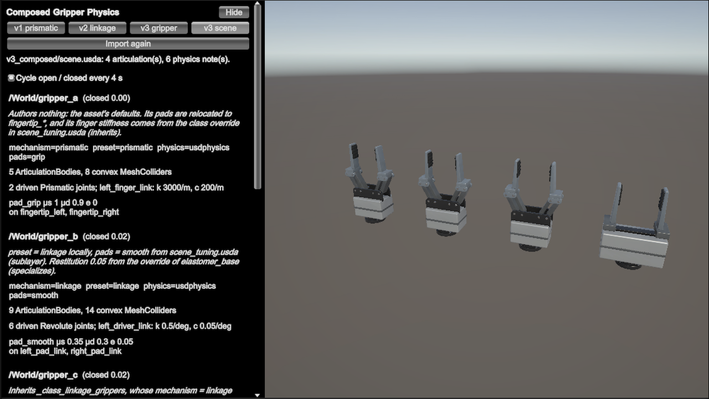

# Composed Gripper Physics

> A vendor-neutral two-finger gripper authored with core UsdPhysics that imports as one ArticulationBody tree with convex colliders and drives, with its physics spread across sublayers, inherits, variants, references, payloads, specializes and relocates.


The sample ships one gripper design in three USD versions and imports them with
`UsdImportOptions.ImportPhysics` (**Import Physics** on a USD asset):

| | **v1_prismatic** | **v2_linkage** | **v3_composed** |
|---|---|---|---|
| Finger mechanism | each finger slides on a prismatic joint | each finger rides a four-bar parallelogram (driver + follower link) | both, chosen by variant |
| Closed loop | none (a tree) | one per side, closed by a revolute joint with `excludeFromArticulation = true` | as v1 / v2 |
| Driven joints | 2 linear drives | 6 angular drives (driver, follower, finger per side) | as v1 / v2 |
| In Unity | 5 `ArticulationBody`, 8 convex `MeshCollider` | 9 `ArticulationBody`, 14 convex `MeshCollider`, 2 physics notes | as v1 / v2; `scene.usda` gives four articulations |

v3 recombines v1 and v2 so that every OpenUSD composition arc carries part of the physics, and
its composed result is the same gripper. Unity composes the stage with OpenUSD before it builds
anything, so inherits, variants, specializes and relocates are resolved before the physics import
sees them: what reaches Unity is the composed value, whichever arc supplied it.

The asset uses core UsdPhysics only: no PhysX, Isaac, Newton or MuJoCo schemas. It's original work,
made for this sample, and has no vendor names, part numbers or product dimensions.

## Use it in Play Mode or a player



Open `ComposedGripperPhysics.unity` and press Play. The **Composed Gripper Demo** object imports the
asset named in `StartWith` (the v3 scene by default), sets the stage's gravity (`UsdPhysicsScene.Apply`),
puts a `GripperDrive` on every articulation root and frames the camera. A panel on the left, which
**H** (`TogglePanelKey`) hides, has:

- **v1 prismatic / v2 linkage / v3 gripper / v3 scene**: the asset to import. For **v3 gripper** a
  second row picks the `preset` variant (`prismatic`, `linkage`, `linkage_smooth`), passed as
  `UsdImportOptions.VariantSelections`.
- **Cycle open / closed**: every gripper opens and closes every 4 seconds. Clear it to set the
  **Closing** fraction with a slider.
- A box per gripper with what composed: the variant selections, the number of articulation bodies
  and colliders, the finger drive's authored stiffness and damping, and the pad material with the
  links that carry it.
- The import's `PhysicsNotes`.

If the scene already holds a gripper import, made in edit mode with the window or an **Import …**
menu item, the demo uses that one instead of importing `StartWith` again, and the panel starts on
its asset and preset. An import below the **Composed Gripper Demo** object is preferred. Clear
`UseSceneImport` to always import `StartWith`. Choosing another asset in the panel replaces the
import as usual; the edit-mode import comes back when Play Mode ends.

The scene runs in a player too: a build that includes `ComposedGripperPhysics.unity` copies the USD
files to `StreamingAssets/ComposedGripperPhysics`.

## Use it in edit mode

**USD Toolkit > Composed Gripper Physics > Window** is the same panel in edit mode. It imports the
chosen asset into the open scene, frames it in the Scene view, and opens and closes every gripper
with **Closing** or **Cycle** while you inspect the `ArticulationBody` tree, the colliders and the
`UsdPhysicsJoint` / `UsdPhysicsBody` components. Choosing another asset or preset replaces the
window's import, and selecting any other gripper import in the Hierarchy shows that one.

Physics doesn't run in edit mode, so there each `GripperDrive` poses its links where the joints
would put them: on the parent link's anchor, turned about (or moved along) the anchor's X axis by
the joint target. That's the pose the articulation reaches in Play Mode when the drives hold their
targets, so the linkage stays a parallelogram and the fingers stay parallel. The
**Closing** and **Cycle Seconds** fields on a `GripperDrive` work in the Inspector too.

Before Play Mode starts and before a scene is saved, every gripper goes back to the pose the import
built, so the articulations start from the authored rest pose and a scene file never keeps an
edit-mode pose. The grippers pose again right after the save.

The **Import v1 prismatic** to **Import v3 scene** items in the same menu import an asset without
the window.

From code:

```csharp
var options = new UsdImportOptions { ImportPhysics = true };
options.VariantSelections.Add(new UsdVariantSelection("/composed_gripper", "preset", "linkage"));
UsdImportResult result = UsdImporter.Import(path + "/v3_composed/gripper.usda", options);
```

The USD files are in the sample's `USD~` folder, which Unity doesn't import as assets: v3's
physics sublayers hold no geometry, and imported one by one each would only warn. Copy a version's
folder into `Assets` to import its `gripper.usda` as a USD asset; keep the folder together, since
the layers reference each other by relative path.

## Driving the gripper

`GripperDrive` sits on an articulation root and sets the same closing fraction on every driven
joint of that articulation: 0 is open (joint value 0), 1 is the joint limit with the larger
magnitude. In Play Mode the targets go to the drives through `UsdPhysicsJoint.SetDriveTarget`, in
the asset's units and sign; in edit mode they pose the links (see above). For v2 that's driver and
follower 40°, finger −40°, targets that keep the parallelogram closed exactly.

Unity can't build v2's loop-closing joints: a Unity joint can't sit on an articulation link, so the
import reports each in `PhysicsNotes` and skips it. The coordinated drives hold the linkage
instead. Under a heavy grip the finger can tilt slightly, as far as its drive's stiffness and
`maxForce` allow. In Isaac Sim (PhysX), which honours `excludeFromArticulation`, the loop is closed
and the drives agree with it.

## v3_composed: what each arc does

```
gripper.usda
└─ /composed_gripper  (Xform, kind=component, defaultPrim)
   ├─ variants: preset    = prismatic (default) | linkage | linkage_smooth
   │                        ← each variant authors selections for mechanism / pads
   │            mechanism = prismatic | linkage                ← defined here AND in the payload
   │            physics   = usdphysics (default) | none
   │            pads      = grip | smooth                      ← set + default (grip) inside the payload
   ├─ Materials                        reference @./geometry/materials.usd@
   ├─ Geometry
   │    {mechanism=…}  <link>          reference @./geometry/<mechanism>/<link>.usd@
   └─ {physics=usdphysics}
        ├─ payload @./physics/gripper_physics.usda@
        │    subLayers: pads.usda, joints.usda, bodies.usda, classes.usda
        └─ Physics/Materials  reference @./physics/physics_materials.usda@
              elastomer_base (PhysicsMaterialAPI) ◄─ specializes ─ pad_grip, pad_smooth
/PhysicsScene
```

| Arc | Where | What it carries |
|---|---|---|
| **Sublayers** | the payload's root layer → `pads`, `joints`, `bodies`, `classes`; `scene.usda` → `layers/scene_tuning.usda` | The physics split by concern, and scene-wide tuning in a layer of its own. |
| **Inherits** | `classes.usda` | `_class_rigid_link` (rigid body, mass, filtered pairs), `_class_convex_collider` (collision, `convexHull`, `purpose = guide`) and one class per joint role with its axis, limits, `excludeFromArticulation` and drive. Left and right joints author only their bodies and frames. |
| **Variants** | the root prim | One `mechanism` selection switches the geometry (root layer) *and* the physics (payload layers), because both define a variant set of that name. `physics = none` gives a visual-only asset, `pads` swaps the pad friction material, and `preset` selects a mechanism and pads together. |
| **References** | the root layer | Per-link render geometry, the render materials and the physics material library. |
| **Payloads** | `physics = usdphysics` | All bodies, colliders and joints. |
| **Specializes** | `physics_materials.usda` | `pad_grip` / `pad_smooth` specialize `elastomer_base`. An override of the base in a stronger layer reaches what a pad doesn't author (restitution), but never the pad's own friction. |
| **Relocates** | `scene.usda` | Renames `gripper_a`'s pad links to `fingertip_left` / `fingertip_right` without touching the asset. The joints and filtered pairs that target them follow. |

### The v3 scene: variant selections through different arcs

A variant selection is a composed opinion like any other, so in `scene.usda` each gripper gets its
selections through a different arc. The panel shows the result:

| Gripper | What the scene authors | Unity gets |
|---|---|---|
| `gripper_a` | nothing | `preset = prismatic`, `mechanism = prismatic`, `pads = grip`: the asset's defaults, from its root layer, a variant of `preset` and the payload. Its pads arrive as **fingertip_left / fingertip_right** (relocates), and its finger drive stiffness is **3000** instead of 2000: `scene_tuning.usda` overrides the class the finger joints inherit. |
| `gripper_b` | `preset = linkage` locally; `pads = smooth` in `scene_tuning.usda` | linkage with `pad_smooth`: friction **0.35 / 0.3** from the pad, restitution **0.05** from the scene's override of `elastomer_base` (specializes). |
| `gripper_c` | inherits `/_class_linkage_grippers`, which selects `mechanism = linkage` | linkage with `preset` still `prismatic`: the class in the scene's layer stack beats the selection `preset` makes in the referenced asset. |
| `gripper_d` | references `presets/linkage_smooth.usda` instead of `gripper.usda` | linkage with `pad_smooth` (restitution 0): the preset file pins the selections between the scene and the asset. |

## Conventions

- Z up, meters, kilograms. The flange face is at z = 0 and the fingers point along +Z; X is the
  stroke axis, the left finger at −X. The import turns the stage Y-up.
- Each link's frame sits on its joint pivot, and the rest pose is fully open. Joint value 0 is
  open; the right side mirrors the left, so the same target closes both fingers.
- Angular limits and targets are in degrees, and angular drive gains are per degree, as UsdPhysics
  authors them; the import converts them to Unity's per-radian gains.
- Colliders are separate `collision_<n>` meshes under each link, every one convex
  (`convexHull`). Non-convex parts are split by hand rather than with `convexDecomposition`.
- `PhysicsFilteredPairsAPI` filters every pair on one side and the base against every link. Left
  against right stays enabled, so the jaws can't pass through each other; at full close the pads
  keep a 4 mm gap.

## Validating the USD files

`USD~/source/validate.py` checks the shipped files:

```
pip install usd-core numpy
python USD~/source/validate.py                                                   # all checks, all versions
```

It runs OpenUSD's validators (including the UsdPhysics ones) and checks that each
articulation forms a spanning tree, that joint frames coincide at rest, that every collider is
convex, that no unfiltered pair interpenetrates across the stroke, and that v2's loops stay closed
under the coordinated targets. For v3 it also checks both mechanisms, the arc census of
`scene.usda`, and which arc supplied each variant selection and each inherited, specialized and
relocated value. All three versions pass with OpenUSD 26.08.

## Files

| File | What it is |
|---|---|
| `ComposedGripperPhysics.unity` | The Play Mode scene: a camera, a light and the **Composed Gripper Demo** object. |
| `Scripts/ComposedGripperDemo.cs` | The Play Mode side: imports, applies the stage's gravity, frames the camera and draws the panel in the Game view. |
| `Scripts/ComposedGripperPanel.cs` | The panel both modes draw: asset and preset, closing controls, and per gripper what composed. |
| `Scripts/GripperDrive.cs` | Opens and closes one gripper: through its `UsdPhysicsJoint` drives in Play Mode, by posing its links in edit mode. |
| `Scripts/ComposedGripperImport.cs` | The assets, the import options (`ImportPhysics`, the `preset` selection) and camera framing. |
| `Editor/ComposedGripperWindow.cs` | **USD Toolkit > Composed Gripper Physics > Window**: the panel in edit mode, and the reset to the rest pose before Play Mode and saving. |
| `Editor/ComposedGripperMenu.cs` | The **Import …** items in the same menu. |
| `Editor/ComposedGripperBuildStep.cs` | Copies the USD files to StreamingAssets for a player build. |
| `USD~/v1_prismatic`, `USD~/v2_linkage` | `gripper.usda` (root layer), `geometry/` (a layer per link, referenced), `physics/gripper_physics.usd` (payload). |
| `USD~/v3_composed` | `gripper.usda`, `scene.usda`, `layers/`, `presets/`, `geometry/`, `physics/`. |
| `USD~/source/validate.py` | The Python script that validates the files. |
